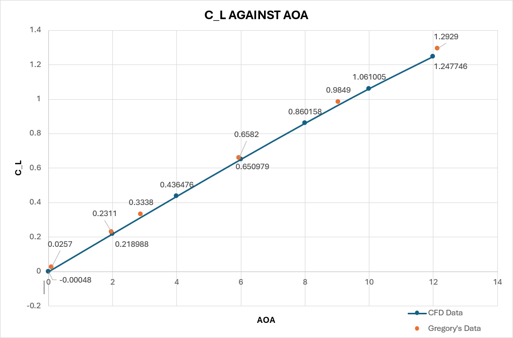
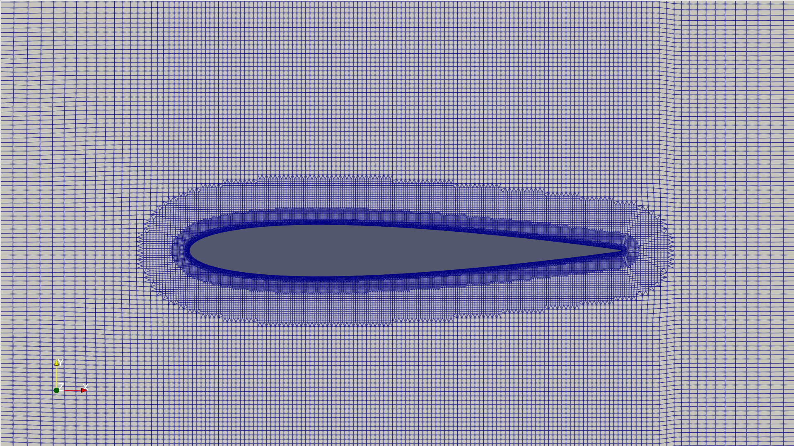
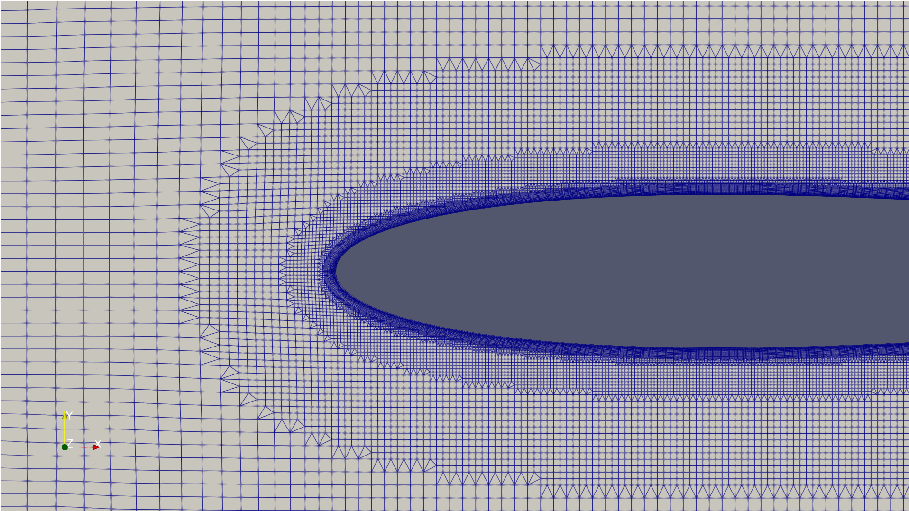
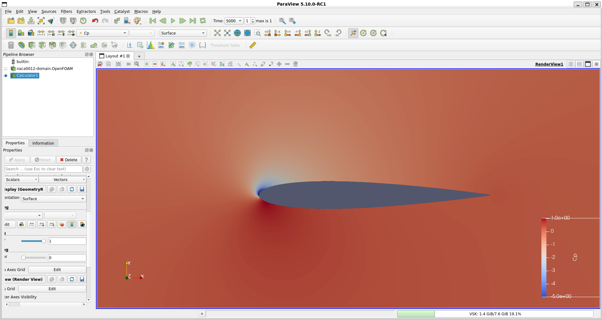

# NACA 0012 CFD Validation in OpenFOAM

Steady RANS simulation of a NACA 0012 aerofoil at Re = 3×10⁶ in OpenFOAM 11,
built from CAD through post-processing and correlated against tripped wind-tunnel
data.



## Key Results

| Metric | CFD | Reference | Error |
|---|---|---|---|
| Lift-curve slope (0-6° fit) | 0.1086 /deg | 0.1082 /deg (Gregory) | +0.38% |
| CL @ 12° | 1.248 | 1.280 (Gregory, raw, interpolated) | -2.5% |
| CL @ 0° | −0.0005 | 0 (symmetric) | ≈0 |
| Maximum L/D | 62.05 (at 10°) | — | — |

## Validation

Compared against Gregory & O'Reilly (lift) and Ladson, NASA TM 4074
(drag, Reynolds-corrected) — both tripped datasets, matched to the fully-turbulent
Spalart-Allmaras setup used here.

- Symmetry check: CL and Cm are near 0 (CL −0.0005, Cm −0.00006) at α = 0° on a symmetric section
- y⁺: 0.81 average, 3.05 max
- Grid independence: Refinement zone was extended from 24 mm to 100 mm from the wall, the CL and CD values changed by 0.015% and 3.8% respectively on the 10-Chord meshes.
- Domain sensitivity: 10 vs 50 chords changed CD by 26% — identified and corrected

## Post-processing

- How to run it: `python scripts/postprocess.py` from the repo root.
- What it does: reads all 7 runs, takes each run’s last row, compares it with results/polar_50c.csv, and checks convergence on Cl, Cd and Cm over the last 500 iterations (0.1% relative tolerance, 1e-6 absolute floor).
- Comparison: all 7 angles match to within 5e-7, which is the rounding limit of the 6-decimal CSV.
- Convergence: Cl converged from 2° to 12°; Cd from 2° to 10°; Cm still drifting from 4° upward (up to 1.7% of its value at 12°). Only 2° passes on all three.
- 0° run: stopped at iteration 1277 on residualControl, while Cl was still drifting towards zero (−0.0029 at iteration 778, −0.0005 at 1277). The effect on the 0° to 6° lift-curve slope is 0.32% to 0.38% against Gregory.
- The checks can fail: reading the wrong angle’s file fails the comparison, and a truncated 800-line file fails convergence on all three coefficients.

## Method

| | |
|---|---|
| Aerofoil | NACA 0012, 1 m chord |
| Reynolds number | 3×10⁶ |
| Mesh | blockMesh + snappyHexMesh, ~186k cells, 22 prism layers |
| Solver | OpenFOAM 11, incompressibleFluid, SIMPLE |
| Turbulence | Spalart-Allmaras, fully turbulent |

## Mesh




## Flow Visualisation

### Pressure Contours (12° AoA)



## Limitations

- Lift is well-correlated; the lift-dependent drag term is not — still almost
  2× experiment, candidates narrowed but not resolved
- Steady RANS only; the blunt trailing edge sheds, untested near/at stall
- Fully turbulent — no transition model
- 50-chord domain, short of the ~500-chord guidance for fully domain-independent drag
- Force coefficients are still drifting at the last iteration: Cl converged from 2° to 12°, Cd from 2° to 10°, Cm hasn't converged (up to 1.7% at 12°)
- The 0° run stopped at 1,277 iterations due to residualControl, with Cl still approaching 0. Its effect on the slope is 0.32% to 0.38%

## Debugging Highlights

Two implementation faults were found through physical-consistency checks rather
than solver diagnostics: force coefficients computed in the wrong reference frame
(caught via a symmetry argument — drag cannot fall with incidence on a symmetric
section) and a boundary layer left completely unresolved by the mesh (caught via
an order-of-magnitude L/D check). [Full log →](docs/DEBUGGING_LOG.md)

## Run the checks

- Requires python with Pandas (`pip install pandas`). From the repo root:

```bash
python scripts/postprocess.py
```

## References

1. Gregory, N. & O’Reilly, C.L. (1970) *Low-Speed Aerodynamic Characteristics of NACA 0012 Aerofoil Section, including the Effects of Upper-Surface Roughness Simulating Hoar Frost*, ARC R&M 3726.
2. Ladson, C.L. (1988) *Effects of Independent Variation of Mach and Reynolds Numbers on the Low-Speed Aerodynamic Characteristics of the NACA 0012 Airfoil Section*, NASA TM 4074.
3. OpenFOAM User Guide, OpenFOAM 11.
